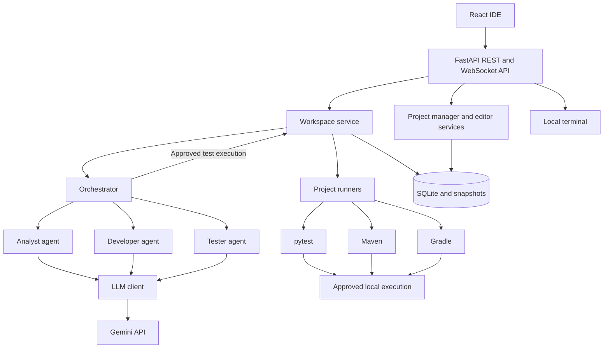
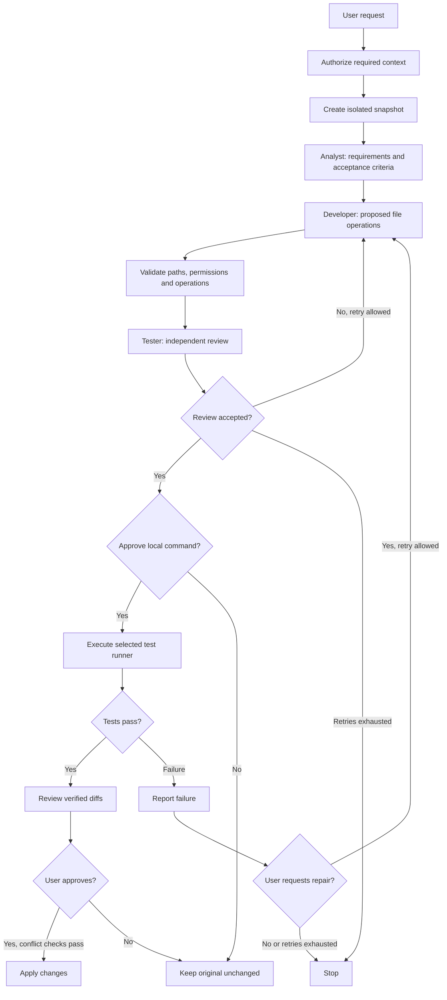

# CMF Dev Studio

**AI-powered development. Human-controlled changes.**

CMF Dev Studio is an open-source, local-first, browser-based development environment that combines an integrated code editor, a multi-agent AI assistant and approved local testing. It helps developers evolve existing repositories or create new projects while retaining control over the files shared with AI and the changes applied to their code.

[](https://github.com/cmartinferrer/cmf-dev-studio/actions/workflows/ci.yml) [](https://github.com/cmartinferrer/cmf-dev-studio/actions/workflows/security.yml) [](LICENSE)    

> **Development status:** Alpha. The Python, Java and Kotlin reference workflows have been validated end to end. The project is actively evolving; review the current limitations before using it with important repositories.

## Contents

- [Project background](#project-background)
- [Features](#features)
- [Architecture](#architecture)
- [Agent workflow](#agent-workflow)
- [Supported languages](#supported-languages)
- [Technology stack](#technology-stack)
- [Getting started](#getting-started)
- [Using the IDE](#using-the-ide)
- [Configuration](#configuration)
- [Project structure](#project-structure)
- [Testing](#testing)
- [Code quality](#code-quality)
- [Continuous integration](#continuous-integration)
- [Security and privacy](#security-and-privacy)
  - [Dependency security](#dependency-security)
- [Extending the platform](#extending-the-platform)
- [Current limitations](#current-limitations)
- [Roadmap](#roadmap)
- [Contributing](#contributing)
- [Author](#author)
- [License](#license)

## Project background

CMF Dev Studio began as a personal learning exercise to understand agentic AI, multi-agent collaboration and orchestration in software engineering. The initial experiment brought together three specialized agents — Analyst, Developer and Tester — to explore how they could collaborate on a software development task.

As the experiment evolved, it grew into an integrated development environment with repository-level changes, automated review, approved local testing, and explicit human approval. A single language-independent orchestrator now coordinates workflows for Python, Java and Kotlin.

The project remains an ongoing learning and engineering initiative. By releasing it as open source under the MIT License, the aim is to share the experience, encourage collaboration and provide a practical foundation for developers interested in exploring AI-powered software engineering.

## Features

- **Integrated workspace:** project registry, language selection, file explorer, search, Monaco editor, file tabs and an interactive local terminal.
- **File management:** create, rename, delete, move, copy and paste files and folders; drag and drop, multi-selection and automatic numbered copies prevent accidental overwrites.
- **AI-assisted development:** describe a change in natural language and receive a repository-level proposal with requirements, acceptance criteria and file diffs.
- **Single orchestrator:** Analyst, Developer and Tester collaborate through one language-independent workflow.
- **Multi-language testing:** automatic runner selection for Python/pytest, Java/Maven and Kotlin/Gradle.
- **Iterative review:** bounded functional review and test-quality guidance; failed tests can trigger a user-requested repair, with fresh approval before executing a changed proposal.
- **Explicit context approval:** inspect and authorize eligible file contents before they are provided to the AI provider. The active file is suggested automatically; additional files can be selected manually or through the explorer.
- **Conversational workflow:** inline approvals, persisted chat history and retries with original or updated context.
- **Human-controlled application:** review and test isolated changes before explicitly applying them to the original project.
- **Local persistence:** SQLite project registry and proposal history, with snapshots stored on disk.

## Architecture



| Component | Responsibility |
| --- | --- |
| `orchestrator.py` | Coordinates planning, implementation, review and bounded test/repair cycles. |
| `agents/` | Owns role-specific prompts and agent behavior. |
| `contracts.py` | Defines structured response contracts and parsing. |
| `workflow.py` | Defines technology identification and retry policy. |
| `workspaces.py` | Manages proposal lifecycle, snapshots, persistence, permissions and safe application. |
| `project_runners.py` | Selects and executes native test adapters. |
| `projects/` | Manages project registration, browsing, context discovery and editor operations. |
| `llm/` | Defines the provider interface and Gemini adapter. |
| `api/` | Exposes local REST and terminal WebSocket endpoints. |
| `frontend/` | Provides the browser-based IDE and proposal review experience. |

The orchestrator is the sole agent coordination module. The workspace service supplies filesystem and persistence operations; the runners execute tests rather than making agent decisions. The same repository workflow is used regardless of the target language.

## Agent workflow



Generation and testing are separate phases of a persisted proposal. Failed tests can be repaired without starting a new task. Changed proposals require fresh execution approval; infrastructure failures are reported separately. Functional review and generated tests are guided by the original acceptance criteria. Agent reviews do not replace actual test execution or developer review.

## Supported languages

| Language | Detection | Test runner | Runtime |
| --- | --- | --- | --- |
| Python | Python source files | pytest | Python 3.12 |
| Java | Root `pom.xml` | Maven 3.9 | JDK 21 |
| Kotlin / Java | Root `build.gradle.kts` or `build.gradle` | Gradle 8.14 | JDK 21 |

The Maven and Gradle adapters require test sources under `src/test/`. The Gradle reference project uses Kotlin. Runner selection prioritizes Maven, then Gradle, then Python. Commands execute using locally installed tools after explicit approval. Maven and Gradle can resolve dependencies over the network. Python verification currently uses the Studio Python environment; independent project environments and automated dependency preparation are not yet implemented. The versions in the table describe reference workflows, not mandatory versions for every project.

## Technology stack

| Layer | Technologies |
| --- | --- |
| Backend | Python, FastAPI, Uvicorn, Pydantic, SQLite |
| Frontend | React, TypeScript, Vite, Lucide |
| Editor and terminal | Monaco Editor, xterm.js, local PTY |
| AI | Google Gemini SDK, structured JSON responses |
| Execution | pytest, Maven, Gradle |
| Tooling | uv, npm, pytest, Ruff |

## Getting started

### Prerequisites

- Python 3.10 or newer and a compatible version of uv.
- Node.js 20 or 22 and npm.
- Native build tools for the languages you use.
- A Gemini API key and access to the model configured in `src/cmf_dev_studio/llm/gemini.py`.
- A POSIX development environment (Linux or macOS) for the integrated PTY terminal.

### Install

From the root of your checkout:

```bash
uv sync --locked
cp .env.example .env
```

Edit `.env` and provide your Gemini API key. Do not commit it.

```bash
cd frontend
npm ci
cd ..
```

### Native test tools

Install Maven and JDK 21 for Java, Gradle for Kotlin, and uv/pytest for Python as needed. Commands run locally with network access after explicit approval in chat. No runner images are required.

### Run the application

**Terminal 1 — Backend (repository root)**

```bash
uv run uvicorn cmf_dev_studio.api.app:app --reload --reload-dir src --host 127.0.0.1 --port 8000
```

Alternatively, `uv run cmf-dev-studio` starts the backend without automatic reload.

**Terminal 2 — Frontend**

```bash
cd frontend
npm run dev
```

Open [http://127.0.0.1:5173](http://127.0.0.1:5173). The frontend proxies API and WebSocket requests to port 8000. API documentation is available at [http://127.0.0.1:8000/docs](http://127.0.0.1:8000/docs).

## Using the IDE

1. Create a managed project or choose **Open existing project** and register a local directory. Select the project language when creating a project or update it from the workspace status bar.
2. Browse and manage files and folders in the explorer. Use Ctrl/Cmd-click or Shift-click for multi-selection, drag and drop to move items, and Copy/Paste to duplicate them. Open files in the editor or use the integrated terminal.
3. Open the assistant and describe a concrete development task. Review the suggested active-file context, remove unwanted files or add context manually, then authorize eligible contents before sending them to the AI provider.
4. Inspect the acceptance criteria, generated file operations and diffs. Approve the displayed native test command before execution.
5. Review the test output. If verification fails, inspect the error and request a repair when appropriate. A changed proposal requires fresh execution approval. Generation retries can reuse the original context or use an explicitly approved replacement.
6. Accept verified changes explicitly using the inline **Accept changes** action, including explicit authorization for registered projects. No project-name confirmation is required.

### Project programming language

New managed projects can select Python, Java or Kotlin. The setting is persisted and supplied to the agents during proposal generation. Existing projects may use automatic detection. Runner selection still follows the build files; the language setting is not a security restriction.

### Example: Java calculator

Copy the reference project outside the application repository so that the integration fixture stays unchanged:

```bash
mkdir -p ~/workspace/java
cp -R examples/java-maven ~/workspace/java/hello-java
```

Register `~/workspace/java/hello-java` and authorize `pom.xml`, `Calculator.java` and `CalculatorTest.java`.

Example request:

> Add a subtract(int a, int b) method to Calculator. Add independent JUnit 5 tests for positive, negative and zero results. Preserve the existing add method and tests. Do not add dependencies or change the build configuration.

The same process works with `examples/kotlin-gradle` and `examples/python-pytest`. The Python fixture is a minimal test-only project; use it as a starting point for a small implementation task.

## Configuration

| Variable | Purpose | Default |
| --- | --- | --- |
| `GEMINI_API_KEY` | Credentials for the Gemini SDK | Required for AI tasks |
| `STUDIO_DATA_DIR` | Registry, managed projects and proposal snapshots | `.studio-data` |
| `STUDIO_BROWSE_ROOT` | Root directory for the folder picker | User home |

The Gemini adapter currently defaults to `gemini-3.5-flash-lite`; model availability depends on the provider and account. The model is configured in code, not through a dedicated environment variable. Export the optional `STUDIO_*` variables in the backend shell before starting it; the API reads them from the process environment. The `.env` file is loaded for AI operations.

Keep `.studio-data/` and `.env` when upgrading. The registry stores absolute project paths, so moving a checkout that contains managed projects can invalidate their paths. Keep the existing checkout location or explicitly migrate those paths before moving it.

## Project structure

```text
cmf-dev-studio/
├── README.md
├── .env.example
├── pyproject.toml
├── uv.lock
├── main.py
├── src/cmf_dev_studio/
│   ├── agents/
│   ├── api/
│   ├── llm/
│   ├── projects/
│   ├── contracts.py
│   ├── orchestrator.py
│   ├── project_runners.py
│   ├── workflow.py
│   └── workspaces.py
├── frontend/
├── examples/
│   ├── python-pytest/
│   ├── java-maven/
│   └── kotlin-gradle/
└── tests/
    └── integration/
```

## Testing

Run the backend unit and API tests:

```bash
uv run pytest -q -m "not integration"
```

Optionally run native integration tests (requires installed build tools):

```bash
uv run pytest -q -m integration
```

The parametrized integration test uses the three reference projects and verifies automatic runner selection and real test execution. It does not call Gemini. Missing native tools cause the corresponding integration test to be skipped.

Build the frontend:

```bash
cd frontend
npm run build
```

For end-to-end verification, open each reference project in the IDE, submit a change, authorize context, inspect test results and apply the verified proposal. This requires valid Gemini credentials.

## Code quality

Ruff is a locked development dependency used to lint and format the Studio Python code. Its configuration lives in `pyproject.toml`, targets Python 3.10 and uses an 88-character line length. The locked Ruff version provides the default lint rule selection.

Run these checks from the repository root:

```bash
uv run --locked ruff check .
uv run --locked ruff format --check .
```

To apply automatic lint fixes and formatting locally:

```bash
uv run --locked ruff check . --fix
uv run --locked ruff format .
```

Review the resulting diff and run the tests before committing. Do not apply unsafe fixes indiscriminately. Ruff is a development tool for CMF Dev Studio, not a mandatory requirement for projects generated by its agents.

## Continuous integration

The CI workflow runs on pushes to `main`, pull requests targeting `main`, and manual dispatch. It validates:

- **Backend (Python 3.10 and 3.12):** locked dependencies, Ruff linting, Ruff formatting and non-integration pytest tests.
- **Frontend (Node.js 22):** locked npm dependencies and production build.
- **Secret scanning:** Gitleaks scans repository history.

Native integration tests and Gemini-powered end-to-end checks are separate from the standard CI backend test run. Dependency audits are described below.

## Security and privacy

- The application is intended for a trusted local user. Bind the backend and frontend to loopback; do not expose them to untrusted networks.
- Repository context is explicitly approved and checked for sensitive files and credential patterns. These checks are not a guarantee that all secrets are detected.
- Approved context and task information are transmitted to Gemini; local-first does not mean offline AI or that all data remains on the machine.
- Approved test commands run with your user permissions and Internet access in a disposable copy. This is not a security sandbox. Code can access your home directory and network.
- Applying a proposal requires explicit approval and conflict checks. Local code can still access original repositories.
- The integrated terminal runs on the host with the user's permissions; it is not sandboxed.
- Use trusted repositories only. This application is not a hardened security boundary for hostile code or multi-tenant deployment.

### Dependency security

CMF Dev Studio automatically audits its dependencies for known security vulnerabilities.

- **Frontend:** `npm audit`, blocking high and critical vulnerabilities.
- **Backend:** `pip-audit`, scanning locked Python production dependencies.
- **Secret scanning:** Gitleaks, detecting accidentally committed credentials.

Dependency security audits run on pull requests targeting `main`, pushes to `main`, and weekly scheduled executions. They can also be triggered manually from GitHub Actions.

Dependabot provides automated dependency update pull requests. These audits detect known vulnerabilities and do not guarantee that dependencies are free of security issues.

## Extending the platform

To add a language or build tool, extend technology identification in `workflow.py`, eligible context discovery in `projects/intelligence.py` as needed, and runner selection/execution in `project_runners.py`. Add a native command, reference project and integration case. Keep orchestration language-independent.

To add an AI provider, implement the `LLMClient` contract in `llm/`, including structured responses where supported, and wire the provider into workspace orchestration. Add provider and agent-contract tests. Provider selection is not currently a user-facing setting.

## Current limitations

- Only the documented native runner combinations are supported for verification. Python tests currently use the Studio environment; automatic per-project dependency installation and independent execution environments are not implemented. Arbitrary Maven/Gradle dependency graphs and multi-module builds are not guaranteed to work.
- The assistant supports conversational change proposals and retries, but is not yet a general-purpose coding assistant.
- Explorer copy and move operations are limited to the current project and do not automatically refactor imports or code references.
- Context discovery and snapshots have size and file-count limits. Generated changes and tests may be incorrect despite successful verification.
- The application is a local alpha, not a production-hosted IDE. There is no multi-user authentication or authorization boundary.
- Gemini access requires connectivity, credentials and provider availability.

## Roadmap

Potential next steps include independent project execution environments, approved dependency preparation, richer repository understanding, Git integration and broader runner coverage. These are planned directions, not implemented features.

## Contributing

Contributions, ideas and feedback are welcome. If you would like to improve the architecture, extend language support, refine agent workflows or enhance the developer experience, feel free to open an issue or submit a pull request.

Please keep changes focused, run Ruff lint and format checks, include relevant tests and preserve the project's explicit context authorization and human approval safeguards. Never include credentials, private repository contents or local application data in contributions.

## Author

**Cristian Martín Ferrer** — Software engineer interested in software architecture, backend development, artificial intelligence and continuous learning.

GitHub: [cmartinferrer](https://github.com/cmartinferrer)

## License

CMF Dev Studio is open-source software released under the [MIT License](LICENSE).

Copyright © 2026 Cristian Martín Ferrer.