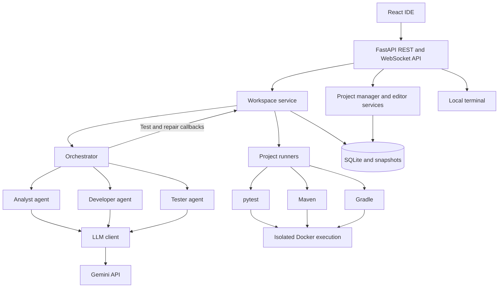
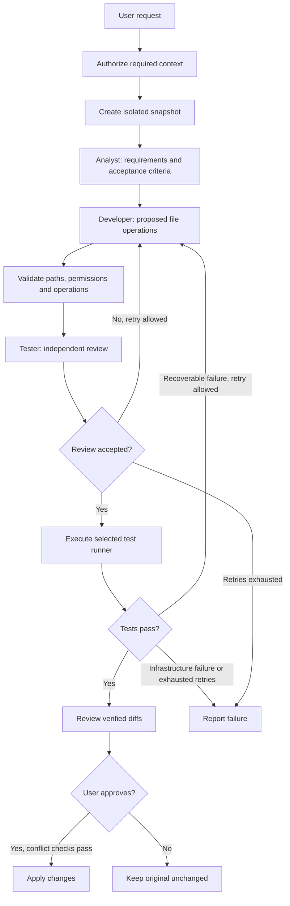

# CMF Dev Studio

**AI-powered development. Human-controlled changes.**

CMF Dev Studio is an open-source, local-first, browser-based development environment that combines an integrated code editor, a multi-agent AI assistant and isolated automated testing. It helps developers evolve existing repositories or create new projects while retaining control over the files shared with AI and the changes applied to their code.

[](LICENSE)    

> **Development status:** Alpha. The Python, Java and Kotlin reference workflows have been validated end to end. The project is actively evolving; review the current limitations before using it with important repositories.

## Contents

- [Project background](#project-background)
- [Features](#features)
- [Architecture](#architecture)
- [Agent workflow](#agent-workflow)
- [Supported languages](#supported-languages)
- [Technology stack](#technology-stack)
- [Getting started](#getting-started)
- [Using the IDE](#using-the-ide)
- [Configuration](#configuration)
- [Project structure](#project-structure)
- [Testing](#testing)
- [Security and privacy](#security-and-privacy)
- [Extending the platform](#extending-the-platform)
- [Current limitations](#current-limitations)
- [Roadmap](#roadmap)
- [Contributing](#contributing)
- [Author](#author)
- [License](#license)

## Project background

CMF Dev Studio began as a personal learning exercise to understand agentic AI, multi-agent collaboration and orchestration in software engineering. The initial experiment brought together three specialized agents — Analyst, Developer and Tester — to explore how they could collaborate on a software development task.

As the experiment evolved, it grew into an integrated development environment with repository-level changes, automated review and repair, isolated testing, and explicit human approval. A single language-independent orchestrator now coordinates workflows for Python, Java and Kotlin.

The project remains an ongoing learning and engineering initiative. By releasing it as open source under the MIT License, the aim is to share the experience, encourage collaboration and provide a practical foundation for developers interested in exploring AI-powered software engineering.

## Features

- **Integrated workspace:** project registry, file explorer, search, Monaco editor, file tabs, save/delete operations and an interactive local terminal.
- **AI-assisted development:** describe a change in natural language and receive a repository-level proposal with requirements, acceptance criteria and file diffs.
- **Single orchestrator:** Analyst, Developer and Tester collaborate through one language-independent workflow.
- **Multi-language testing:** automatic runner selection for Python/pytest, Java/Maven and Kotlin/Gradle.
- **Iterative repair:** bounded review and test-driven correction attempts, with infrastructure failures distinguished from code failures.
- **Explicit context approval:** inspect and authorize eligible file contents before they are provided to the AI provider.
- **Human-controlled application:** review and test isolated changes before explicitly applying them to the original project.
- **Local persistence:** SQLite project registry and proposal history, with snapshots stored on disk.

## Architecture



| Component | Responsibility |
| --- | --- |
| `orchestrator.py` | Coordinates planning, implementation, review and bounded test/repair cycles. |
| `agents/` | Owns role-specific prompts and agent behavior. |
| `contracts.py` | Defines structured response contracts and parsing. |
| `workflow.py` | Defines technology identification and retry policy. |
| `workspaces.py` | Manages proposal lifecycle, snapshots, persistence, permissions and safe application. |
| `project_runners.py` | Selects and executes Docker-based test adapters. |
| `projects/` | Manages project registration, browsing, context discovery and editor operations. |
| `llm/` | Defines the provider interface and Gemini adapter. |
| `api/` | Exposes local REST and terminal WebSocket endpoints. |
| `frontend/` | Provides the browser-based IDE and proposal review experience. |

The orchestrator is the sole agent coordination module. The workspace service supplies filesystem and persistence operations; the runners execute tests rather than making agent decisions. The same repository workflow is used regardless of the target language.

## Agent workflow



Generation and testing are separate phases of a persisted proposal. Failed tests can be retried without starting a new task. Agent reviews do not replace actual test execution or developer review.

## Supported languages

| Language | Detection | Test runner | Runtime |
| --- | --- | --- | --- |
| Python | Python source files | pytest | Python 3.12 |
| Java | Root `pom.xml` | Maven 3.9 | JDK 21 |
| Kotlin / Java | Root `build.gradle.kts` or `build.gradle` | Gradle 8.14 | JDK 21 |

The Maven and Gradle adapters require test sources under `src/test/`. The Gradle reference project uses Kotlin. Runner selection prioritizes Maven, then Gradle, then Python. Dependencies must be available in the runner image; arbitrary dependencies are not downloaded during verification.

## Technology stack

| Layer | Technologies |
| --- | --- |
| Backend | Python, FastAPI, Uvicorn, Pydantic, SQLite |
| Frontend | React, TypeScript, Vite, Lucide |
| Editor and terminal | Monaco Editor, xterm.js, local PTY |
| AI | Google Gemini SDK, structured JSON responses |
| Execution | Docker, pytest, Maven, Gradle |
| Tooling | uv, npm, pytest |

## Getting started

### Prerequisites

- Python 3.10 or newer and a compatible version of uv.
- Node.js 20 or 22 and npm.
- Docker Engine or Docker Desktop, running and able to mount your project directories.
- A Gemini API key and access to the model configured in `src/cmf_dev_studio/llm/gemini.py`.
- A POSIX development environment (Linux or macOS) for the integrated PTY terminal.

### Install

From the root of your checkout:

```bash
uv sync --locked
cp .env.example .env
```

Edit `.env` and provide your Gemini API key. Do not commit it.

```bash
cd frontend
npm ci
cd ..
```

### Build test runner images

Run from the repository root. The initial image builds require Internet access to fetch dependencies.

```bash
docker build -f docker/project-test-runner.Dockerfile -t cmf-dev-studio-runner-python:0.1.0 .
docker build -f docker/maven-test-runner.Dockerfile -t cmf-dev-studio-runner-maven:0.1.0 .
docker build -f docker/gradle-test-runner.Dockerfile -t cmf-dev-studio-runner-gradle:0.1.0 .
```

### Run the application

**Terminal 1 — Backend (repository root)**

```bash
uv run uvicorn cmf_dev_studio.api.app:app --reload --reload-dir src --host 127.0.0.1 --port 8000
```

Alternatively, `uv run cmf-dev-studio` starts the backend without automatic reload.

**Terminal 2 — Frontend**

```bash
cd frontend
npm run dev
```

Open [http://127.0.0.1:5173](http://127.0.0.1:5173). The frontend proxies API and WebSocket requests to port 8000. API documentation is available at [http://127.0.0.1:8000/docs](http://127.0.0.1:8000/docs).

## Using the IDE

1. Create a managed project or choose **Open existing project** and register a local directory.
2. Browse files in the explorer, open them in the editor, or use the integrated terminal.
3. Open the assistant and describe a concrete development task. If existing files are needed, choose and preview the context, then authorize it and retry the request.
4. Inspect the acceptance criteria, generated file operations and diffs. The assistant runs the appropriate tests in an isolated snapshot.
5. Review the test output. If verification fails, inspect the error or retry after addressing the cause.
6. Accept verified changes explicitly. Existing projects require additional write authorization; follow the confirmation shown by the IDE.

### Example: Java calculator

Copy the reference project outside the application repository so that the integration fixture stays unchanged:

```bash
mkdir -p ~/workspace/java
cp -R examples/java-maven ~/workspace/java/hello-java
```

Register `~/workspace/java/hello-java` and authorize `pom.xml`, `Calculator.java` and `CalculatorTest.java`.

Example request:

> Add a subtract(int a, int b) method to Calculator. Add independent JUnit 5 tests for positive, negative and zero results. Preserve the existing add method and tests. Do not add dependencies or change the build configuration.

The same process works with `examples/kotlin-gradle` and `examples/python-pytest`. The Python fixture is a minimal test-only project; use it as a starting point for a small implementation task.

## Configuration

| Variable | Purpose | Default |
| --- | --- | --- |
| `GEMINI_API_KEY` | Credentials for the Gemini SDK | Required for AI tasks |
| `STUDIO_DATA_DIR` | Registry, managed projects and proposal snapshots | `.studio-data` |
| `STUDIO_BROWSE_ROOT` | Root directory for the folder picker | User home |

The Gemini adapter currently defaults to `gemini-3.5-flash-lite`; model availability depends on the provider and account. The model is configured in code, not through a dedicated environment variable. Export the optional `STUDIO_*` variables in the backend shell before starting it; the API reads them from the process environment. The `.env` file is loaded for AI operations.

Keep `.studio-data/` and `.env` when upgrading. The registry stores absolute project paths, so moving a checkout that contains managed projects can invalidate their paths. Keep the existing checkout location or explicitly migrate those paths before moving it. No database schema changes are required for this branding release.

## Project structure

```text
cmf-dev-studio/
├── README.md
├── .env.example
├── pyproject.toml
├── uv.lock
├── main.py
├── src/cmf_dev_studio/
│   ├── agents/
│   ├── api/
│   ├── llm/
│   ├── projects/
│   ├── contracts.py
│   ├── orchestrator.py
│   ├── project_runners.py
│   ├── workflow.py
│   └── workspaces.py
├── frontend/
├── docker/
├── examples/
│   ├── python-pytest/
│   ├── java-maven/
│   └── kotlin-gradle/
└── tests/
    └── integration/
```

## Testing

Run the backend unit and API tests:

```bash
uv run pytest -q -m "not integration"
```

After building all three runner images, run the real Docker integration tests:

```bash
uv run pytest -q -m integration
```

The parametrized integration test uses the three reference projects and verifies automatic runner selection and real test execution. It does not call Gemini. The examples must be accessible to the Docker daemon through bind mounts.

Build the frontend:

```bash
cd frontend
npm run build
```

For end-to-end verification, open each reference project in the IDE, submit a change, authorize context, inspect test results and apply the verified proposal. This requires valid Gemini credentials.

## Security and privacy

- The application is intended for a trusted local user. Bind the backend and frontend to loopback; do not expose them to untrusted networks.
- Repository context is explicitly approved and checked for sensitive files and credential patterns. These checks are not a guarantee that all secrets are detected.
- Approved context and task information are transmitted to Gemini; local-first does not mean offline AI or that all data remains on the machine.
- Test containers mount proposal snapshots read-only, copy them into temporary writable storage, run as a non-root user, drop capabilities and have network access disabled. Resource limits and timeouts are enforced.
- Original repositories are not mounted in test containers. Applying a proposal requires explicit approval and conflict checks.
- The integrated terminal runs on the host with the user's permissions; it is not the Docker test sandbox.
- Use trusted repositories only. This application is not a hardened security boundary for hostile code or multi-tenant deployment.

## Extending the platform

To add a language or build tool, extend technology identification in `workflow.py`, eligible context discovery in `projects/intelligence.py` as needed, and runner selection/execution in `project_runners.py`. Supply a Docker image with the required dependencies and add a reference project and integration case. Keep orchestration language-independent.

To add an AI provider, implement the `LLMClient` contract in `llm/`, including structured responses where supported, and wire the provider into workspace orchestration. Add provider and agent-contract tests. Provider selection is not currently a user-facing setting.

## Current limitations

- Only the documented runner combinations and preinstalled dependencies are supported for verification. JVM caches are seeded from the reference projects; arbitrary Maven/Gradle dependency graphs and multi-module builds are not guaranteed to work.
- AI requests are change-oriented; a general-purpose conversational coding assistant is not yet implemented.
- Context discovery and snapshots have size and file-count limits. Generated changes and tests may be incorrect despite successful verification.
- The application is a local alpha, not a production-hosted IDE. There is no multi-user authentication or authorization boundary.
- Gemini access requires connectivity, credentials and provider availability.

## Roadmap

Potential next steps include conversational assistance, smarter context selection, richer repository understanding, extensible dependency preparation and broader runner coverage. These are planned directions, not implemented features.

## Contributing

Contributions, ideas and feedback are welcome. If you would like to improve the architecture, extend language support, refine agent workflows or enhance the developer experience, feel free to open an issue or submit a pull request once the repository is public.

Please keep changes focused, include relevant tests and preserve the project's explicit context authorization and human approval safeguards. Never include credentials, private repository contents or local application data in contributions.

## Author

**Cristian Martín Ferrer** — Software engineer interested in software architecture, backend development, artificial intelligence and continuous learning.

GitHub: [cmartinferrer](https://github.com/cmartinferrer)

## License

CMF Dev Studio is open-source software released under the [MIT License](LICENSE).

Copyright © 2026 Cristian Martín Ferrer.