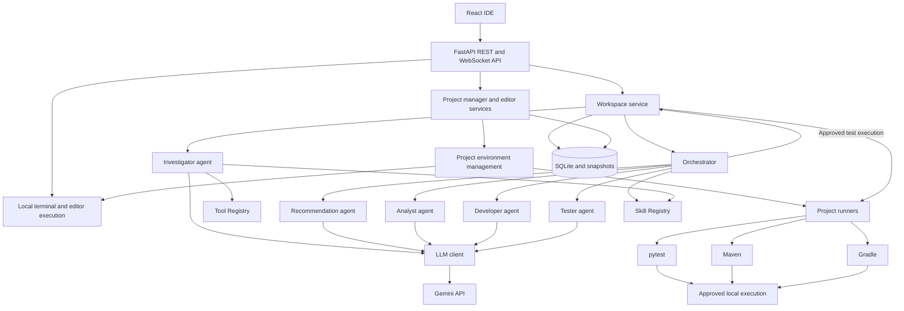
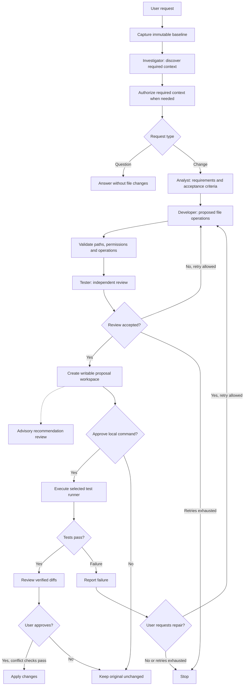

# CMF Dev Studio

**AI-powered development. Human-controlled changes.**

CMF Dev Studio is an open-source, local-first, browser-based development environment that combines an integrated code editor, a multi-agent AI assistant and approved local testing. It helps developers evolve existing repositories or create new projects while retaining control over the files shared with AI and the changes applied to their code.

[](https://github.com/cmartinferrer/cmf-dev-studio/actions/workflows/ci.yml) [](https://github.com/cmartinferrer/cmf-dev-studio/actions/workflows/security.yml) [](LICENSE)   

> **Development status:** Alpha. The Python, Java and Kotlin development workflows have been validated end to end, including project environments, approved testing, preparation and editor execution. The project is actively evolving; review the current limitations before using it with important repositories.

## Contents

- [Project background](#project-background)
- [Features](#features)
- [Architecture](#architecture)
- [Agent workflow](#agent-workflow)
- [Supported languages](#supported-languages)
- [Technology stack](#technology-stack)
- [Getting started](#getting-started)
- [Using the IDE](#using-the-ide)
- [Configuration](#configuration)
- [Project structure](#project-structure)
- [Testing](#testing)
- [Code quality](#code-quality)
- [Continuous integration](#continuous-integration)
- [Security and privacy](#security-and-privacy)
  - [Dependency security](#dependency-security)
- [Extending the platform](#extending-the-platform)
- [Current limitations](#current-limitations)
- [Roadmap](#roadmap)
- [Contributing](#contributing)
- [Author](#author)
- [License](#license)

## Project background

CMF Dev Studio began as a personal learning exercise to understand agentic AI, multi-agent collaboration and orchestration in software engineering. The initial experiment brought together three specialized agents — Analyst, Developer and Tester — to explore how they could collaborate on a software development task.

As the experiment evolved, it grew into an integrated development environment with repository-level changes, automated review, approved local testing, and explicit human approval. A single language-independent orchestrator now coordinates workflows for Python, Java and Kotlin.

The project remains an ongoing learning and engineering initiative. By releasing it as open source under the MIT License, the aim is to share the experience, encourage collaboration and provide a practical foundation for developers interested in exploring AI-powered software engineering.

## Features

- **Integrated workspace:** project registry, language selection, file explorer, search, Monaco editor, file tabs and an interactive local terminal.
- **File management:** create, rename, delete, move, copy and paste files and folders; drag and drop, multi-selection and automatic numbered copies prevent accidental overwrites.
- **AI-assisted development:** describe a change in natural language and receive a repository-level proposal with requirements, acceptance criteria and file diffs.
- **Agentic assistant:** Investigator, Analyst, Developer, Tester and Recommendation agents support repository questions and change proposals through a language-independent workflow.
- **Tool and skill registries:** reusable repository investigation tools and dynamically selected procedural guidance, with visible technical activity.
- **Recommendation policy:** optional improvements and critical findings, with follow-up suggestions suppressed when applying earlier recommendations.
- **Project environments:** select or create Python virtual environments with uv, or select a locally installed JDK for Java and Kotlin. Settings are persisted per project.
- **Integrated execution:** project-specific environments are used by the terminal and agent test runners. Bash and Zsh initialization preserves the selected environment without editing personal shell configuration.
- **Multi-language testing:** automatic runner selection for Python/pytest, Java/Maven and Kotlin/Gradle, with priority given to existing Maven and Gradle wrappers.
- **Project preparation:** explicitly approve dependency installation for Python or compilation and tests for JVM projects after applying changes.
- **Run from the editor:** execute Python scripts, conventional Java and Kotlin entry points and JVM test classes, with terminal output, exit codes, Stop and Run again.
- **Iterative review:** bounded functional review and test-quality guidance; failed tests can trigger a user-requested repair, with fresh approval before executing a changed proposal.
- **Explicit context approval:** inspect and authorize eligible file contents before they are provided to the AI provider. The active file is suggested automatically; additional files can be selected manually or through the explorer.
- **Conversational workflow:** multiple persistent conversations per project, follow-up questions, inline approvals and retries with original or updated context.
- **Terminal context:** attach bounded terminal output to a request, with credential-pattern redaction.
- **External projects:** register existing local directories, remove registrations without deleting source files, or explicitly delete projects from disk.
- **Fresh investigation context:** historical assistant answers are reused only when the bounded project snapshot is unchanged. After a source change, user requests remain available for continuity, but old answers are omitted from the model context. Current dependencies require fresh evidence and exploration approval when needed. The visible chat history is preserved.
- **Human-controlled application:** review and test isolated changes before explicitly applying them to the original project.
- **Local persistence:** SQLite project registry and proposal history. An immutable baseline is captured per request; a writable proposal workspace is created only when file operations are generated. Completed proposals retain only the files needed for historical diffs; answered requests release their snapshots.

## Architecture



| Component | Responsibility |
| --- | --- |
| `orchestrator.py` | Coordinates planning, implementation, review and bounded test/repair cycles. |
| `agents/` | Owns role-specific prompts and agent behavior. |
| `tools/` | Registers and executes bounded repository investigation tools. |
| `skills/` | Loads trusted Markdown skills and selects guidance per agent role. |
| `recommendations.py` | Supports recommendation policy and review decisions. |
| `terminal_context.py` | Normalizes and bounds terminal evidence, including credential redaction. |
| `contracts.py` | Defines structured response contracts and parsing. |
| `workflow.py` | Defines technology identification and retry policy. |
| `workspaces.py` | Manages proposal lifecycle, snapshots, persistence, permissions and safe application. |
| `project_runners.py` | Selects and executes native test adapters using project environments and available build wrappers. |
| `projects/` | Manages project registration, browsing, context discovery, editor operations, environment selection and project execution support. |
| `llm/` | Defines the provider interface and Gemini adapter. |
| `api/` | Exposes local REST and terminal WebSocket endpoints. |
| `frontend/` | Provides the browser-based IDE and proposal review experience. |

The orchestrator coordinates proposal generation; the workspace service also manages investigation and conversational request routing. The workspace service supplies filesystem and persistence operations; the runners execute tests rather than making agent decisions. The same repository workflow is used regardless of the target language.

## Agent workflow



The diagram summarizes the main paths rather than every retry or approval state. Investigation uses registered tools and approved context. Recommendation review is advisory and does not replace the functional review or test execution.

Generation and testing are separate phases of a persisted proposal. Failed tests can be repaired without starting a new task. Changed proposals require fresh execution approval; infrastructure failures are reported separately. Functional review and generated tests are guided by the original acceptance criteria. Agent reviews do not replace actual test execution or developer review.

## Supported languages

| Language | Detection | Test runner | Reference runtime |
| --- | --- | --- | --- |
| Python | Python source files | pytest via uv | Python 3.12 |
| Java | Root `pom.xml` | Maven / Maven Wrapper | JDK 17 or 21 |
| Kotlin / Java | Root `build.gradle.kts` or `build.gradle` | Gradle / Gradle Wrapper | JDK 21 |

The Maven and Gradle adapters require test sources under `src/test/`. The Gradle reference project uses Kotlin. Runner selection prioritizes Maven, then Gradle, then Python. Existing wrappers take precedence over globally installed build tools. Commands execute locally after explicit approval and can resolve dependencies over the network.

Python agent tests use isolated uv environments with the selected project interpreter when configured. Java and Kotlin runners use the selected JDK through `JAVA_HOME` and `PATH`. The reference versions are not mandatory for every project; the selected runtime must be compatible with the project's build configuration.

## Technology stack

| Layer | Technologies |
| --- | --- |
| Backend | Python, FastAPI, Uvicorn, Pydantic, SQLite |
| Frontend | React, TypeScript, Vite, Lucide |
| Editor and terminal | Monaco Editor, xterm.js, local PTY |
| AI | Google Gemini SDK, structured JSON responses |
| Execution | uv, pytest, Maven, Gradle, Maven Wrapper, Gradle Wrapper |
| Tooling | uv, npm, pytest, Ruff |

## Getting started

### Prerequisites

- Python 3.10 or newer and a compatible version of uv.
- Node.js 20 or 22 and npm.
- A compatible Python interpreter or JDK for the languages you use; Maven or Gradle if the project does not provide a corresponding wrapper.
- A Gemini API key and access to the model configured in `src/cmf_dev_studio/llm/gemini.py`.
- A POSIX development environment (Linux or macOS) for the integrated PTY terminal.

### Install

From the root of your checkout:

```bash
uv sync --locked
cp .env.example .env
```

Edit `.env` and provide your Gemini API key. Do not commit it.

```bash
cd frontend
npm ci
cd ..
```

### Native test tools

Install compatible JDKs for Java and Kotlin and use existing Maven or Gradle wrappers where available. Otherwise, make the corresponding build tool available on the backend PATH. Python uses uv for environment management and test execution. Commands run locally with network access after explicit approval in chat. No runner images are required. The IDE does not automatically install JDKs, Maven or Gradle globally.

### Run the application

**Terminal 1 — Backend (repository root)**

```bash
uv run uvicorn cmf_dev_studio.api.app:app --reload --reload-dir src --host 127.0.0.1 --port 8000
```

Alternatively, `uv run cmf-dev-studio` starts the backend without automatic reload.

**Terminal 2 — Frontend**

```bash
cd frontend
npm run dev
```

Open [http\://127.0.0.1:5173](http\://127.0.0.1:5173). The frontend proxies API and WebSocket requests to port 8000. API documentation is available at [http\://127.0.0.1:8000/docs](http\://127.0.0.1:8000/docs).

## Using the IDE

1. Create a project in a selected local directory or choose **Open existing project** and register a local directory. Select the project language when creating a project or update it from the workspace status bar.
2. Browse and manage files and folders in the explorer. Use Ctrl/Cmd-click or Shift-click for multi-selection, drag and drop to move items, and Copy/Paste to duplicate them. Open files in the editor or use the integrated terminal.
3. Open the assistant and describe a concrete development task. Review the suggested active-file context, remove unwanted files or add context manually, then authorize eligible contents before sending them to the AI provider.
4. Inspect the acceptance criteria, generated file operations and diffs. Approve the displayed native test command before execution.
5. Review the test output. If verification fails, inspect the error and request a repair when appropriate. A changed proposal requires fresh execution approval. Generation retries can reuse the original context or use an explicitly approved replacement.
6. Accept verified changes explicitly using the inline **Accept changes** action, before writing to the project directory. No project-name confirmation is required.

7. Optionally approve project preparation after applying changes. Python preparation creates or reuses a project virtual environment and installs declared dependencies; JVM preparation compiles and tests the actual project.
8. Open a supported source or test file and use **Run** to execute it in the integrated terminal. Use **Stop** or **Run again** to control the execution.

### AI conversations
Each project has independent, persistent conversations. Use the assistant history, new conversation and options controls to switch, rename, clear or delete a conversation. Dates and times use the browser's local timezone. Clearing or deleting a conversation discards its pending proposals and review snapshots, but never reverts project files. Conversation switching and deletion are disabled during active AI operations. Removing a project from the workspace also removes its conversation history and proposal snapshots, but preserves its source files. Deleting a project from disk additionally removes its source files.

Use the assistant for repository questions as well as change requests. Follow-up requests can refer to earlier answers or recommendations. Attach relevant terminal output when diagnosing errors; terminal evidence does not implicitly authorize source files. The technical activity shows investigation tools, selected skills and recommendation review outcomes.

### Recommendations

The assistant can suggest relevant improvements after generating changes. Applying an earlier recommendation, including mixed requests, selects critical-only review to avoid an endless chain of optional suggestions. Explicit requests for analysis can still ask for further improvements. Critical findings are advisory, not a security guarantee.

### Workspace layout

The top bar displays the Studio brand only. Use Overview to create, open or switch projects. Right-click the project root in Explorer to rename the active project. The compact tool rail provides Overview, Explorer, AI Assistant and Terminal actions. Toggle Explorer or AI Assistant to reclaim editor space; drag the existing separators to resize panels. Explorer and assistant visibility and panel dimensions are remembered in browser local storage across projects and reloads. Hiding a panel preserves its mounted state; switching projects still closes the current workspace and prompts before discarding unsaved edits. Terminal sessions are not restored after a page reload.

### Project programming language

New projects can select Python, Java or Kotlin. The setting is persisted and supplied to the agents during proposal generation. Existing projects may use automatic detection. Runner selection still follows the build files; the language setting is not a security restriction.

### Project environments

Use the workspace status bar to configure the environment for the current project.

- **Python:** detect an existing `.venv`, create a virtual environment using uv or select an existing interpreter. Agent verification uses an isolated environment rather than installing proposed dependencies into the Studio environment.
- **Java and Kotlin:** detect locally installed JDKs and select the desired version. The selected JDK is used by the terminal, agent runners, project preparation and editor execution.

Environment settings are persisted per project. Restart the integrated terminal after changing an environment. The IDE preserves personal Bash and Zsh configuration and does not change the system default runtime.

### Project preparation

After accepting a proposal in a project, the assistant can offer to prepare it. This is optional and requires explicit approval. Python preparation installs declared dependencies into the project environment. JVM preparation runs the appropriate Maven or Gradle build and tests in the actual project, using its selected JDK and wrapper when available. Unlike proposal verification, preparation can create build artifacts in the original workspace.

### Running code from the editor

Open and save a supported file, then select **Run**. Python scripts execute with the project interpreter. Conventional Java and Kotlin entry points are compiled and executed through the project's build tool; JVM test classes run through Maven or Gradle. Auxiliary JVM classes without a supported entry point are not executable.

The integrated terminal displays process output and exit status, with **Stop** and **Run again** controls. Advanced launch configurations, debugging and complex multi-module builds are not supported in this release.

### Example: Java calculator

Copy the reference project outside the application repository so that the integration fixture stays unchanged:

```bash
mkdir -p ~/workspace/java
cp -R examples/java-maven ~/workspace/java/hello-java
```

Register `~/workspace/java/hello-java` and authorize `pom.xml`, `Calculator.java` and `CalculatorTest.java`.

Example request:

> Add a subtract(int a, int b) method to Calculator. Add independent JUnit 5 tests for positive, negative and zero results. Preserve the existing add method and tests. Do not add dependencies or change the build configuration.

The same process works with `examples/kotlin-gradle` and `examples/python-pytest`. The Python fixture is a minimal test-only project; use it as a starting point for a small implementation task.

## Configuration

| Variable | Purpose | Default |
| --- | --- | --- |
| `GEMINI_API_KEY` | Credentials for the Gemini SDK | Required for AI tasks |
| `STUDIO_DATA_DIR` | Registry and proposal snapshots | `.studio-data` |
| `STUDIO_BROWSE_ROOT` | Root directory for the folder picker | User home |

The Gemini adapter currently defaults to `gemini-3.5-flash-lite`; model availability depends on the provider and account. The model is configured in code, not through a dedicated environment variable. Export the optional `STUDIO_*` variables in the backend shell before starting it; the API reads them from the process environment. The `.env` file is loaded for AI operations.

Keep `.studio-data/` and `.env` when upgrading between compatible versions. The registry stores absolute project paths. If upgrading from an incompatible older development schema, stop Studio and move the old data directory to a backup location before starting, then re-register local projects. Removing a project from Studio preserves its source files but removes its Studio conversations and proposal history. Do not delete the backup if it contains project files.

## Project structure

```text
cmf-dev-studio/
├── README.md
├── CHANGELOG.md
├── RELEASING.md
├── .github/workflows/
├── scripts/release.py
├── .env.example
├── pyproject.toml
├── uv.lock
├── main.py
├── src/cmf_dev_studio/
│   ├── agents/
│   ├── api/
│   ├── llm/
│   ├── projects/
│   ├── skills/
│   ├── tools/
│   ├── contracts.py
│   ├── orchestrator.py
│   ├── project_runners.py
│   ├── recommendations.py
│   ├── terminal_context.py
│   ├── workflow.py
│   └── workspaces.py
├── frontend/
├── examples/
│   ├── python-pytest/
│   ├── java-maven/
│   └── kotlin-gradle/
└── tests/
    └── integration/
```

## Testing

Run the backend unit and API tests:

```bash
uv run pytest -q -m "not integration"
```

Optionally run native integration tests (requires installed build tools):

```bash
uv run pytest -q -m integration
```

The parametrized integration test uses the three reference projects and verifies automatic runner selection and real test execution. It does not call Gemini. Missing native tools cause the corresponding integration test to be skipped.

Run frontend tests and build:

```bash
cd frontend
npm run test
npm run build
cd ..
```

For end-to-end verification, open each reference project in the IDE, select its environment, submit a change, authorize context, inspect test results and apply the verified proposal. Also verify approved preparation. Run supported source files and JVM test classes from the editor and check Stop and Run again. AI-assisted steps require valid Gemini credentials. Automated regression tests cover environment selection, shell startup, runner environments, wrappers, preparation and editor execution.

## Code quality

Ruff is a locked development dependency used to lint and format the Studio Python code. Its configuration lives in `pyproject.toml`, targets Python 3.10 and uses an 88-character line length. The locked Ruff version provides the default lint rule selection.

Run these checks from the repository root:

```bash
uv run --locked ruff check .
uv run --locked ruff format --check .
```

To apply automatic lint fixes and formatting locally:

```bash
uv run --locked ruff check . --fix
uv run --locked ruff format .
```

Review the resulting diff and run the tests before committing. Do not apply unsafe fixes indiscriminately. Ruff is a development tool for CMF Dev Studio, not a mandatory requirement for projects generated by its agents.

## Continuous integration

The CI workflow runs on pushes to `main` and `develop`, pull requests targeting either branch, and manual dispatch. It validates:

- **Backend (Python 3.10 and 3.12):** locked dependencies, Ruff linting, Ruff formatting and non-integration pytest tests.
- **Frontend (Node.js 22):** locked npm dependencies and production build.
- **Secret scanning:** Gitleaks scans repository history.

Native integration tests and Gemini-powered end-to-end checks are separate from the standard CI backend test run. Dependency audits are described below.

## Security and privacy

- The application is intended for a trusted local user. Bind the backend and frontend to loopback; do not expose them to untrusted networks.
- Repository context is explicitly approved and checked for sensitive files and credential patterns. These checks are not a guarantee that all secrets are detected.
- Approved context and task information are transmitted to Gemini; local-first does not mean offline AI or that all data remains on the machine.
- Approved test commands run with your user permissions and Internet access in a disposable copy. This is not a security sandbox. Code can access your home directory and network.
- Applying a proposal requires explicit approval and conflict checks. Local code can still access original repositories.
- The integrated terminal and editor execution run on the host with the user's permissions; they are not sandboxed.
- Approved project preparation runs in the actual project. Dependency installation, Maven and Gradle build scripts and wrappers can execute code and access the network and filesystem. Only approve commands and use wrappers from trusted projects.
- Use trusted repositories only. This application is not a hardened security boundary for hostile code or multi-tenant deployment.

### Dependency security

CMF Dev Studio automatically audits its dependencies for known security vulnerabilities.

- **Frontend:** `npm audit`, blocking high and critical vulnerabilities.
- **Backend:** `pip-audit`, scanning locked Python production dependencies.
- **Secret scanning:** Gitleaks, detecting accidentally committed credentials.

Dependency security audits run on pull requests targeting `main` or `develop`, pushes to either branch, and weekly scheduled executions. They can also be triggered manually from GitHub Actions.

Dependabot provides automated dependency update pull requests targeting `develop`. These audits detect known vulnerabilities and do not guarantee that dependencies are free of security issues.

## Extending the platform

To add a language or build tool, extend technology identification in `workflow.py`, eligible context discovery in `projects/intelligence.py` as needed, and runner selection/execution in `project_runners.py`. Add a native command, reference project and integration case. Keep orchestration language-independent.

To add an AI provider, implement the `LLMClient` contract in `llm/`, including structured responses where supported, and wire the provider into workspace orchestration. Add provider and agent-contract tests. Provider selection is not currently a user-facing setting.

### Agent tools

The built-in repository tools (`find`, `search` and `read`) are registered in `tools/builtins.py`. Extend the registry with a tool definition and handler, preserve bounded snapshot access and existing authorization checks, and add focused tests. Repository content is untrusted and cannot grant tool permissions.

### Agent skills

Bundled Markdown skills in `src/cmf_dev_studio/skills/definitions/` contain a JSON metadata header, a blank line, and trusted procedural guidance. The registry selects up to three skills per role using task keywords and role defaults, without extra model calls. Skills are application-owned; repository files cannot register skills or grant permissions. Selected skill names appear in the proposal's technical activity. Add a definition with `roles`, `keywords`, and `default` metadata to extend the registry without changing orchestration. Selection is heuristic, not semantic retrieval.

## Current limitations

- Only the documented native runner combinations are supported for verification. JVM support focuses on conventional single-module projects; arbitrary dependency graphs, custom source layouts and complex multi-module builds are not guaranteed to work.
- Project preparation from chat requires explicit approval. Existing wrappers are supported but are not generated automatically; JDKs and global build tools must be installed separately when needed.
- Editor execution supports Python scripts, conventional JVM entry points and JVM test classes. Debugging, advanced run configurations and custom program arguments are not supported. JDK selection does not automatically resolve build-specific version requirements.
- The assistant supports repository questions, conversational change proposals and retries within bounded context; it is not an unrestricted autonomous coding agent.
- AI-generated recommendations depend on the model and available context. Proactive critical finding detection is not reliable enough to replace dedicated security analysis or manual code review. The absence of findings does not guarantee defect-free or secure code.
- Explorer copy and move operations are limited to the current project and do not automatically refactor imports or code references.
- Context discovery and snapshots have size and file-count limits. Generated changes and tests may be incorrect despite successful verification.
- The application is a local alpha, not a production-hosted IDE. There is no multi-user authentication or authorization boundary.
- Gemini access requires connectivity, credentials and provider availability.

## Roadmap

Potential next steps include smarter environment detection, project metadata (`.cmf`), multiple AI providers and models, Git and GitHub integration, advanced run configurations, debugging, broader runner coverage and improved support for multi-module JVM projects. These are planned directions, not implemented features.

## Contributing

Contributions, ideas and feedback are welcome. If you would like to improve the architecture, extend language support, refine agent workflows or enhance the developer experience, feel free to open an issue or submit a pull request.

Please keep changes focused, run Ruff lint and format checks, include relevant tests and preserve the project's explicit context authorization and human approval safeguards. Never include credentials, private repository contents or local application data in contributions.

Development changes target `develop`. Stable releases are prepared on `release/vX.Y.Z` branches and published automatically after merging into `main`. See [RELEASING.md](RELEASING.md) for the maintainer procedure and [CHANGELOG.md](CHANGELOG.md) for version history.

## Author

**Cristian Martín Ferrer** — Software engineer interested in software architecture, backend development, artificial intelligence and continuous learning.

GitHub: [cmartinferrer](https://github.com/cmartinferrer)

## License

CMF Dev Studio is open-source software released under the [MIT License](LICENSE).

Copyright © 2026 Cristian Martín Ferrer.
